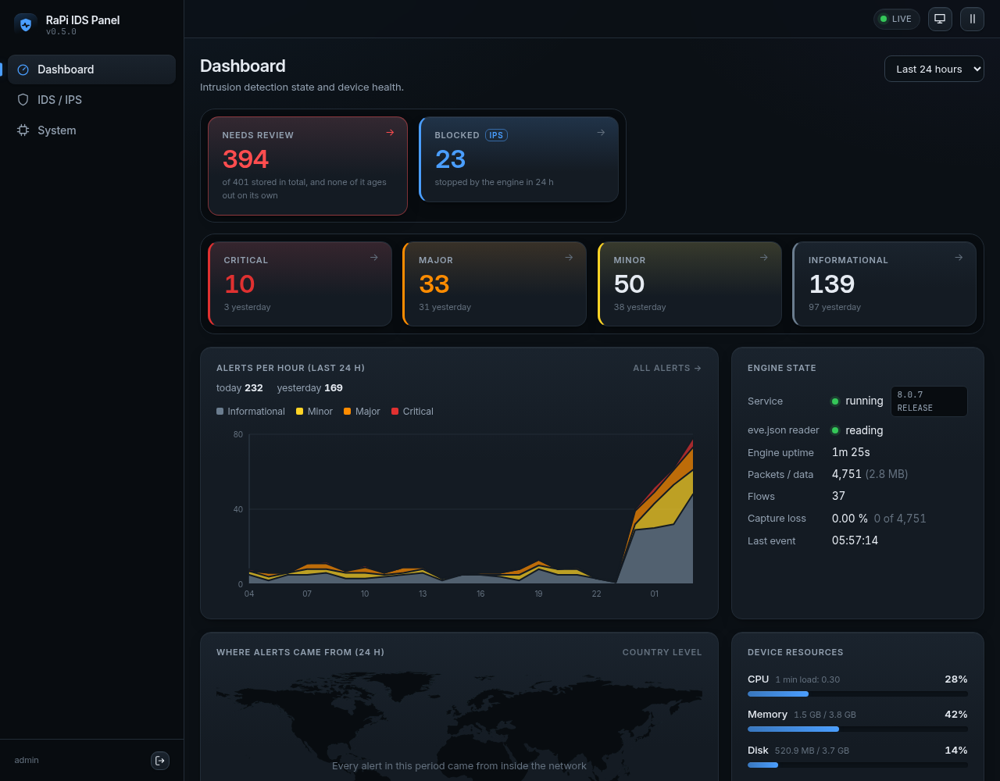
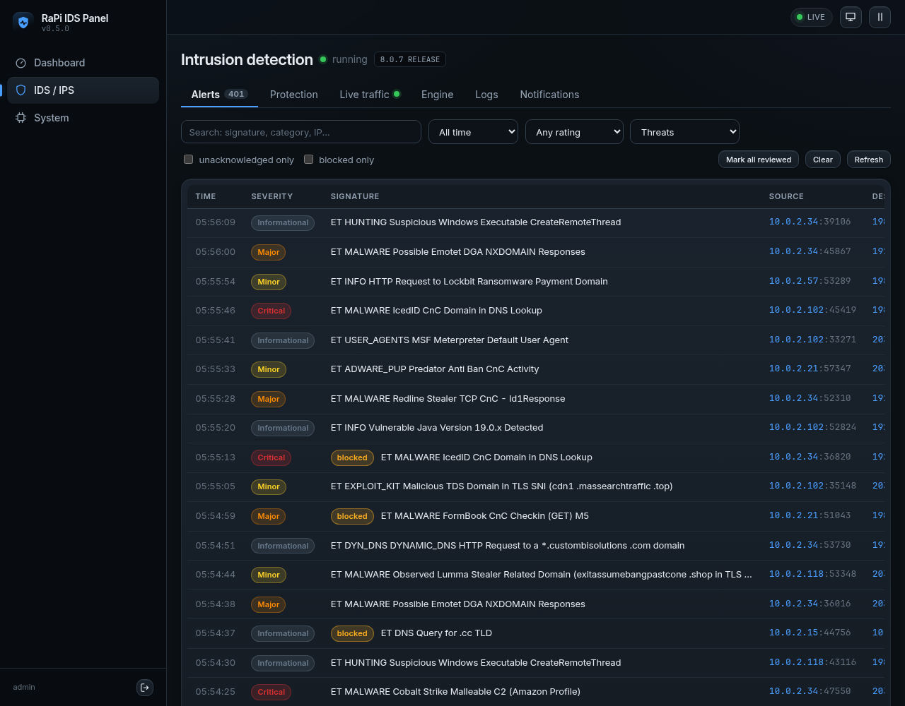
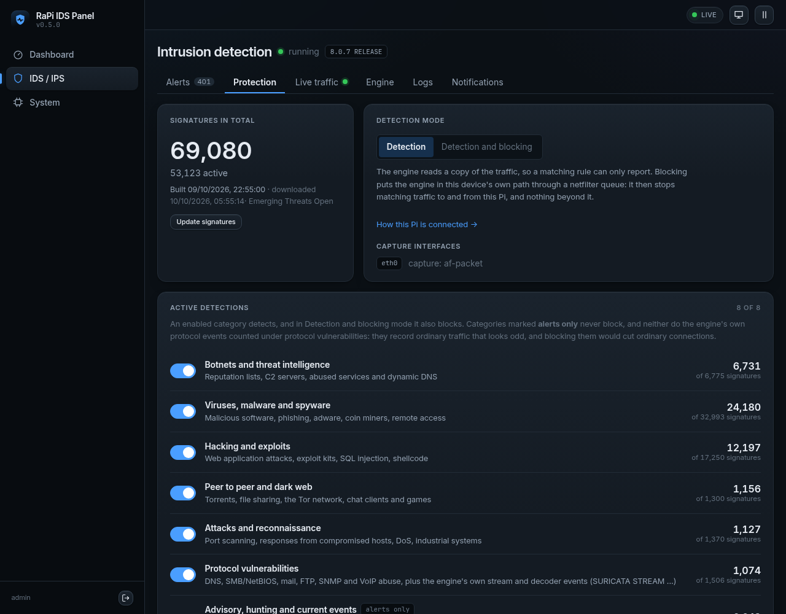
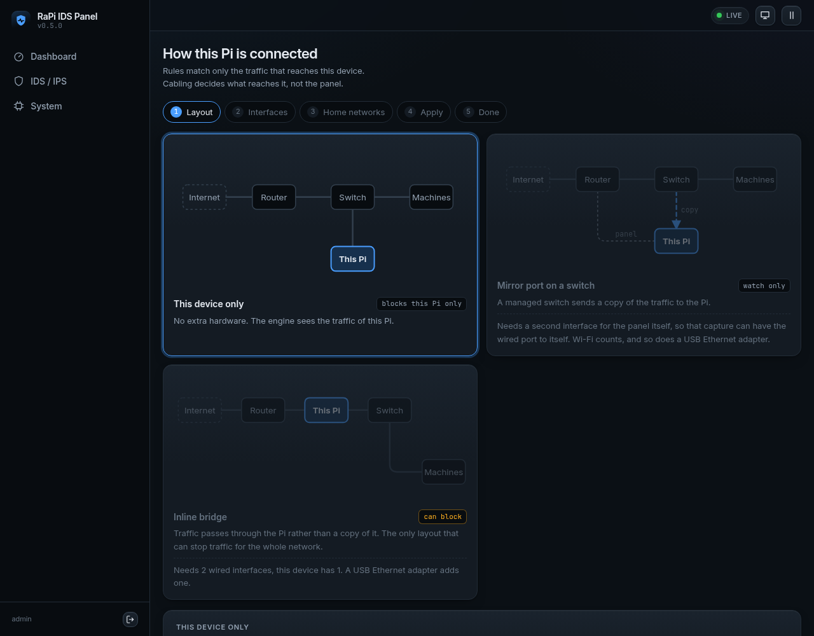
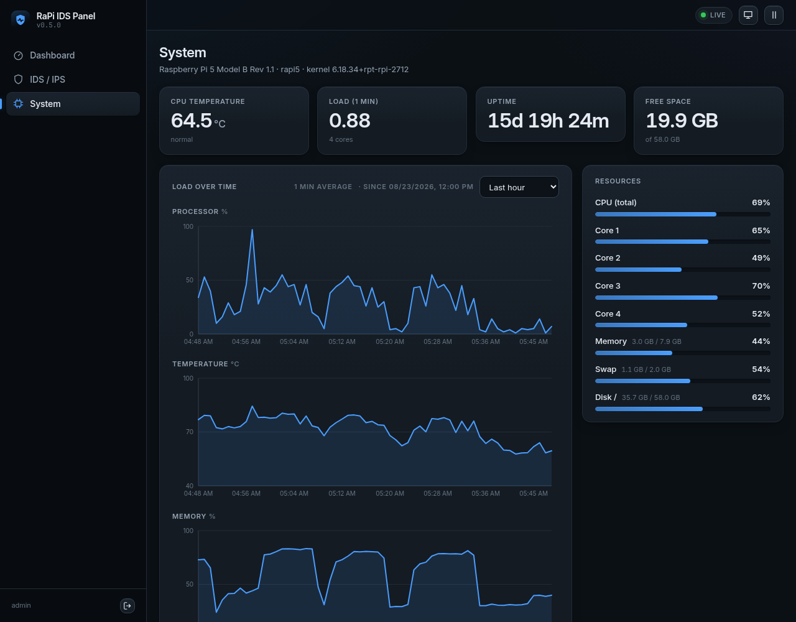

# RaPi IDS

**Is your Raspberry Pi bored? Give it a job: watching your network.**

RaPi IDS turns a Raspberry Pi 5 into a network intrusion detection and
prevention system (IDS/IPS) for a home or small office network. It runs the
Suricata engine with a daily updated rule set and puts everything behind one
clean web GUI: a dashboard, an alert list, and switches for what gets blocked.
Flash a card, plug it in, open a browser. Your network gets a guard, and your
Pi finally has something to do.



## What it does

- **Detects** suspicious traffic with Suricata 8 and the Emerging Threats Open
  rules, refreshed every day.
- **Blocks** it too, when the Pi sits between your router and your network
  and blocking is switched on.
- **Shows** what is happening: live alerts, charts, a world map of sources,
  and the health of the device itself.
- **Fits your network**: watch the Pi's own traffic, a switch mirror port, or
  run inline between router and switch. A wizard detects your hardware and
  walks you through it.
- **Tells you** by e-mail when something needs a look.

| | |
|---|---|
|  |  |
|  |  |

## What you need

- Raspberry Pi 5
- A microSD card; 16 GB or more is recommended. A USB SSD for the logs is
  better still: an IDS writes a lot.
- To block traffic: a second Ethernet port, for example a USB 3 adapter.

## Installation

1. Install [Raspberry Pi Imager](https://www.raspberrypi.com/software/)
   2.0.11 or later.
2. In Imager open **App Options**, then **Content Repository**, choose
   **Use custom URL** and paste:

   ```
   https://github.com/arturpzol/RaPi-IDS/releases/latest/download/rapi-ids.rpi-imager-manifest
   ```

3. Choose **Raspberry Pi 5**, then **RaPi IDS**, then your card. In the
   settings step enter your Wi-Fi (optional), a user name and password, and
   switch SSH on if you want it.
4. Write the card, put it in the Pi, connect Ethernet (or use the Wi-Fi you
   entered) and power it on. The first start takes a minute or two.
5. Open **https://rapi-ids.local** in a browser on the same network. If you
   set a hostname in Imager, the address follows it: `https://<hostname>.local`.
   The address your router gave the Pi works too, and a screen plugged into
   the Pi shows both. Your browser will warn about the
   certificate: the Pi makes its own. The CA certificate to import is on the
   card's boot partition as `rapi-ca.crt`.
6. **Create the panel account right away.** The first person to open the
   panel creates it.
7. Open **How this Pi is connected** and pick your layout.

Prefer the command line? Download the `.img.xz` from
[Releases](https://github.com/arturpzol/RaPi-IDS/releases) and write it with any
tool. Without Imager the card has no Wi-Fi settings, so use Ethernet.

## Licence

RaPi IDS is free software under the
[GNU General Public License v3.0 or later](LICENSE). Contributions are welcome:
see [CONTRIBUTING.md](CONTRIBUTING.md).

Raspberry Pi is a trademark of Raspberry Pi Ltd. RaPi IDS is an independent
project, not affiliated with or endorsed by Raspberry Pi Ltd.
